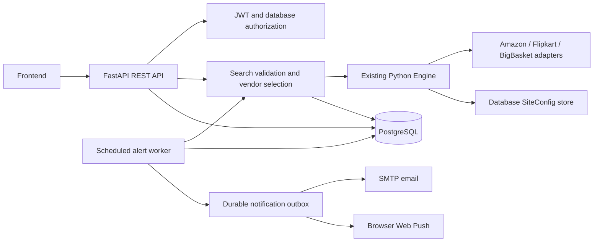

# Architecture and API contract

## Runtime



API sync handlers run in FastAPI's thread pool. One `SearchService` serializes engine searches per process, while the engine scrapes the chosen vendors concurrently. A separate worker checks alerts without running a scheduler in every web process. PostgreSQL is the deployment database; SQLite supports local development.

`DatabaseConfigStore` implements the existing engine `SiteConfigStore`. Engine adapters reread config on each scrape/retry. `DurableScheduler` records running and terminal jobs and terminal engine logs in SQL. The bounded in-process job registry is cleared after persistence. Active attempts/retry progress is not streamed into SQL; admin sees the last stored running state until completion. An interrupted process may leave running searches/jobs for operational investigation; automatic crash recovery of those searches is not implemented.

## Entities

| Table | Main links and purpose |
|---|---|
| `users` | Unique normalized email, Argon2 hash, admin flag, token version |
| `vendors` | Adapter ID and configured supported category list |
| `site_configs` | One JSON engine configuration per vendor |
| `search_history` | Private owner, query/category/sites, status, engine response |
| `products` | Category/name identity, original query, matching anchor |
| `price_listings` | Product + vendor + optional search; append-only observed price snapshots |
| `scraping_jobs` | Engine ID, query/vendor, durable status and JSON engine detail/logs |
| `price_alerts` | Owner + product; threshold, selected sites, trigger/check state |
| `push_subscriptions` | Owner + unique supported browser push endpoint/keys |
| `notifications` | Owner + alert; unique trigger key, payload, delivery attempts/status |

Money is stored as `NUMERIC(14,2)`. Notification payloads use decimal strings. The inherited engine contract retains numeric JSON prices. Timestamps use UTC; clients should localize display. Product IDs hash category and exact case-normalized representative name. Vendor title changes can therefore create a new catalog ID; alert checks use the stored original anchor through the engine's conservative product matcher.

The catalog is shared among authenticated users. Search history, alert settings, and delivery records are private. Removing private history nulls its link on shared observations. Price history is an observation feed, not a claim that an old listing is still available.

## Authentication and request conventions

- Register/login accept JSON `{ "email": "buyer@example.com", "password": "..." }`.
- Login returns `{ "access_token": "...", "token_type": "bearer", "expires_in": 1800 }` by default.
- Supply `Authorization: Bearer <access_token>` to authenticated endpoints.
- Logout revokes every token for that account; a password change also revokes existing tokens.
- Category values: `groceries`, `electronics`, `household`, `fashion`, `beauty`.
- Vendor values: `amazon`, `flipkart`, `bigbasket`.
- Paginated list endpoints accept `limit` and `offset`.
- Client field names outside engine responses use snake_case. The inherited engine response uses camelCase, including `productId`, `bestOffer`, and `effectivePrice`.
- JSON unknown fields are rejected on write schemas. Validation errors use FastAPI's 422 format; operational errors use `{ "detail": "..." }`.

## Endpoints

| Method | Path | Purpose/access |
|---|---|---|
| GET | `/health` | Database connectivity and demo flag; public |
| POST | `/auth/register` | Create an ordinary account; public |
| POST | `/auth/login` | Issue access token; public |
| POST | `/auth/logout` | Revoke account tokens |
| POST | `/auth/change-password` | `current_password`, `new_password`; revoke tokens |
| GET | `/users/me` | Current user profile |
| GET | `/categories` | Supported categories |
| GET | `/vendors` | Vendor IDs, categories, enabled state |
| POST | `/searches` | Run validated search and persist results |
| GET | `/searches` | Current user's history |
| GET/DELETE | `/searches/{id}` | Inspect/delete owned history |
| GET | `/products` | Shared catalog; `q`, `category`, pagination |
| GET | `/products/{id}` | Product anchor/detail |
| GET | `/products/{id}/prices` | Observed prices, newest first; pagination |
| POST/GET | `/alerts` | Create/list owned alerts |
| GET/PATCH/DELETE | `/alerts/{id}` | Owned alert detail, target/active edit, delete |
| GET | `/notifications` | Owned delivery outbox/status |
| GET | `/push/public-key` | Configured public VAPID key |
| POST | `/push/subscriptions` | Register owned browser subscription |
| DELETE | `/push/subscriptions/{id}` | Unregister owned browser subscription |
| GET | `/admin/jobs` | Admin job list with optional `status` filter |
| GET | `/admin/jobs/{id}` | Admin job detail |
| GET | `/admin/jobs/{id}/logs` | Admin engine job logs |
| POST | `/admin/jobs/{id}/retry` | Retry failed/skipped job; optional `category` query, default groceries |
| GET | `/admin/sites` | Site configs, with headers/cookies omitted |
| PATCH | `/admin/sites/{vendor}` | Validated live engine config changes |

Every endpoint except health/register/login/docs requires a JWT. `/admin/*` additionally requires the database admin flag.

## Search request and response

```json
{
  "query": "amul butter 500 g",
  "category": "groceries",
  "vendors": ["amazon", "flipkart", "bigbasket"]
}
```

Omit `vendors` to select enabled compatible sites. An explicit empty list is invalid. The backend checks category membership/site support, not semantic classification of the query.

Response shape (values below are illustrative, not a live quote):

```json
{
  "query": "amul butter 500 g",
  "searchId": "<saved-search-id>",
  "category": "groceries",
  "currency": "INR",
  "demo": true,
  "status": "succeeded",
  "vendors": [{"vendor":"amazon","status":"succeeded","listingCount":3,"attempts":1,"error":null}],
  "results": [{
    "productId": "<product-id>",
    "productName": "Amul Pasteurised Butter 500 g",
    "relevance": 100.0,
    "savings": 0.0,
    "bestOffer": {
      "vendor":"amazon", "productName":"Amul Pasteurised Butter 500 g",
      "price":285.0, "stockStatus":"in_stock", "url":"https://www.amazon.in/...",
      "imageUrl":null, "timestamp":"2026-10-28T00:00:00+00:00", "mrp":305.0,
      "effectivePrice":325.0, "quantity":"500 g"
    },
    "offers": ["<same listing shape as bestOffer>"]
  }]
}
```

Search is synchronous and can take multiple vendor timeouts/retries. Use a loading state and an appropriate HTTP timeout in the frontend. A processed search with all scraper failures returns HTTP 200 and `status: failed`; inspect `vendors[].error`. Invalid input or unavailable compatible sites returns 422 before scraping. `partial` retains successful results. No-results is a successful search with an empty result list when vendors report genuine no-results pages.

## Alert lifecycle

Create with `{ "product_id": "...", "target_price": "500.00", "channel": "email" }`; optionally specify vendors. Push requires a registered subscription and server VAPID configuration. Patch accepts `target_price` and/or `active`; modifying an alert rearms it and cancels old pending notifications.

The scheduler scans up to 100 due active alerts per tick. Each fresh search filters offers by the original product's anchor using the engine matcher. In-stock effective prices at or below target trigger one durable notification. A complete check above target/no in-stock match rearms; incomplete vendor results preserve trigger state unless a qualifying offer is found. Pausing cancels queued delivery, though a delivery already accepted by an external provider cannot be recalled.

Delivery states: `pending` → `sent` or, after five failed attempts, `failed`; edits/pauses can produce `cancelled`. Delivery runs once per minute with the persistent worker. SQL trigger deduplication prevents repeatedly enqueuing while prices remain below target. External delivery is **at least once**: a crash between provider acceptance and SQL commit may duplicate delivery. Partial success across multiple push devices can also produce a repeated notification on retry. No provider-level delivery/read receipt is claimed.

## Admin configuration example

```json
{
  "enabled": true,
  "delivery_fee": "40.00",
  "free_delivery_threshold": "499.00",
  "handling_fee": "0.00",
  "timeout_s": 20,
  "max_retries": 2,
  "min_request_interval_s": 2
}
```

A `selectors` update replaces that dictionary and must contain `item`, `name`, `price`, and `link`; include optional keys you want to retain. URL templates, headers, cookies, and renderer selection are not writable via HTTP. If trusted operators need delivery-location cookies, update the stored engine configuration through a controlled database operation; keep credentials out of source control and API output.
